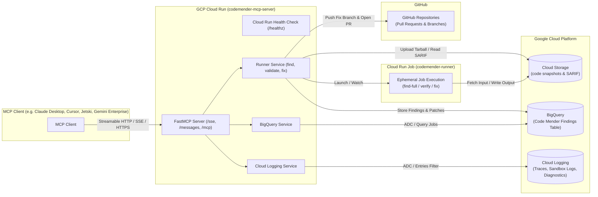

# Code Mender Triage MCP Server (GCP Cloud Run)

A Model Context Protocol (MCP) server running on **Google Cloud Run** to inspect, query, and triage security findings published by **Code Mender** to **BigQuery**, correlated with execution, sandbox, and diagnostic traces from **Cloud Logging**.

---

## Architecture Overview



---

## Features & Capabilities

### 1. Code Mender Execution & Auto-Fix (Cloud Run Jobs & BigQuery)
Launch repository vulnerability scans, exploitability verification, and automated patch generation:
- **`cm_find`**: Scan an entire git repository (e.g. `owner/repo` or HTTPS URL). Clones the repository snapshot, launches an isolated Cloud Run Job (`codemender-runner find-full`), parses SARIF 2.1.0 findings, and persists all vulnerabilities into BigQuery.
- **`cm_validate`**: Run `cm verify` on a finding to test exploitability in an ephemeral sandbox. Updates finding status in BigQuery to `VERIFIED` (exploitable), `FALSE_POSITIVE` (refuted), or `INCONCLUSIVE`.
- **`cm_fix`**: Synthesize a verified fix for a finding using `cm fix`. Stores the unified diff patch in BigQuery, and by default pushes branch `codemender/fix-<finding_id>` and opens a GitHub Pull Request.
- **`cm_apply_patch`**: Re-push an already generated and stored patch to the repository (as a PR or branch).
- **`cm_job_status`**: Poll the execution state (`STAGING`, `RUNNING`, `SUCCEEDED`, `FAILED`) of any find, validate, or fix job, with optional blocking timeout (`wait_seconds`).
- **`cm_list_findings`**: List findings stored in BigQuery filtered by repository, status (`OPEN`, `VERIFIED`, `FALSE_POSITIVE`, `FIXED`, `PATCHED`), or scan job ID.
- **`cm_get_finding`**: Get full finding details including vulnerability fingerprint, CWE/OWASP metadata, unified diff patch, verification verdict, and PR link.

### 2. BigQuery Inspection (Code Mender Findings)
- **`list_codemender_issues`**: Query and filter security issues published by Code Mender. Filter by severity (`CRITICAL`, `HIGH`, `MEDIUM`, `LOW`), status (`OPEN`, `VERIFIED`, `FALSE_POSITIVE`, `INCONCLUSIVE`, `FIXED`, `PATCHED`), repository (`repo`), rule ID / vulnerability type (`rule_id`), scan job (`scan_job_id`), date range, or text search over `message`, `file_path` and `rule_id`.
- **`get_issue_details`**: Fetch full details for a specific issue ID / finding ID, including code snippets, generated patches / diffs, verification results, and remediation status.
- **`get_issues_summary`**: High-level aggregated statistics: total findings, open vs. resolved counts, severity breakdown, and top 5 recurring vulnerabilities.

These tools read the `findings` table that `cm_find` writes (schema: `FINDING_SCHEMA` in `services/runner/store.py`). Column names are resolved from the live table, so a table using the older issue-style names (`issue_id`, `repository`, `vulnerability_type`, `cwe_id`, `session_id`, `title`, `description`) is also readable. `VERIFIED` means a finding was confirmed exploitable; only `FIXED` and `PATCHED` count as resolved.

**Severity mapping.** `cm_find` stores `CRITICAL`, `HIGH`, `MEDIUM` or `LOW` (`services/severity.py`). When the SARIF rule or result carries a `security-severity` score, that decides: 9.0–10.0 `CRITICAL`, 7.0–8.9 `HIGH`, 4.0–6.9 `MEDIUM`, below 4.0 `LOW`. Otherwise the SARIF level decides: `error` → `HIGH`, `warning` → `MEDIUM`, `note`/`none` → `LOW`. Rows stored earlier with the raw level are mapped the same way when read, with the stored value returned as `sarif_level`.

- **`get_bigquery_schema`**: Inspect BigQuery table schemas, columns, types, and descriptions to guide custom queries.
- **`query_codemender_bigquery`**: Execute safe, parameterized, read-only SQL queries (`SELECT` and `WITH` statements only).

### 3. Cloud Logging Correlation (Diagnostics & Traces)
- **`get_issue_logs`**: Automatically correlates logs with a specific finding ID or Code Mender `session_id`. Retrieves compiler output, sandbox execution traces, and error logs.
- **`search_codemender_logs`**: Search Cloud Logging across Code Mender jobs and workers for exceptions, sandbox policy violations (e.g., blocked commands), or scan failures.

### 4. MCP Resources & Prompts
- **Resource `codemender://schema`**: BigQuery schema representation of the findings table.
- **Resource `codemender://critical-issues`**: Live list of the most recent critical findings.
- **Prompt `triage_issue`**: Automated investigation prompt guiding the LLM to inspect the issue in BigQuery, fetch correlated logs, review the patch diff, and recommend next actions.
- **Prompt `diagnose_remediation_failure`**: Automated prompt guiding the LLM to diagnose why a Code Mender patch or verification run failed.

---

## File Structure

```
.
├── .env.example               # Configuration template: copy to .env and fill in (GCP, Runner)
├── config.py                  # Pydantic settings loaded from .env / environment variables
├── server.py                  # FastMCP server with tools, resources, and Cloud Run routes
├── codemender/                # Core CodeMender SARIF 2.1.0 parsing, models, and fingerprinting
├── services/
│   ├── __init__.py
│   ├── bigquery_service.py    # BigQuery client, parameterized queries, and serialization
│   ├── logging_service.py     # Cloud Logging client, filter generation, and formatting
│   ├── runner_service.py      # Runner service manager & lifecycle wrapper
│   └── runner/                # CodeMender execution engine (Cloud Run Jobs, GCS transit, git/PRs)
│       ├── cloud.py           # Cloud Run Jobs client & GCS transit bucket manager
│       ├── repo.py            # Git & GitHub client (cloning, branch push, PR creation)
│       ├── service.py         # CodeMenderService orchestrating find, validate, and fix
│       ├── settings.py        # Runner-specific settings dataclass
│       └── store.py           # BigQueryStore & InMemoryStore for findings and execution jobs
├── tests/
│   ├── __init__.py
│   └── test_server.py         # Unit tests with mocks for BigQuery, Logging, and Runner tools
├── Dockerfile                 # Multi-stage, secure non-root Dockerfile for Cloud Run (git installed)
├── .dockerignore              # Clean container build context
├── requirements.txt           # Python dependencies (mcp, google-cloud-*, uvicorn, requests, etc.)
├── deploy_cloud_run.sh        # Turnkey deployment script for Cloud Run with CLI flags
├── cloudbuild.yaml            # CI/CD pipeline configuration
└── README.md                  # Project documentation
```

---

## Configuration

All settings live in one file: `.env`.

```bash
cp .env.example .env
# then edit .env and fill in your values
```

- **Local runs:** `config.py` reads `.env` automatically.
- **Cloud Run:** `deploy_cloud_run.sh` reads the same `.env` and passes the values to the service. `GITHUB_TOKEN` is stored in Secret Manager and mounted into the service; it is not set as a plain environment variable.
- **Secrets stay out of git and the image:** `.env` is listed in `.gitignore` and `.dockerignore`. Commit `.env.example` only, with placeholder values.
- **Precedence:** environment variables already set in your shell override `.env` for local runs; CLI flags override `.env` for `deploy_cloud_run.sh`.

To change a value later (for example, rotating the GitHub token), edit `.env` and restart the server locally or re-run `./deploy_cloud_run.sh`. The deploy script adds a new secret version only when the value has changed.

| Variable | Description | Default |
| :--- | :--- | :--- |
| `GCP_PROJECT_ID` | GCP Project ID hosting BigQuery, Cloud Run & Logging | ADC Project |
| `REGION` | Cloud Run region | `us-central1` |
| `SERVICE_NAME` | Cloud Run service name (deploy script only) | `codemender-mcp-server` |
| `BQ_DATASET` | BigQuery dataset containing Code Mender findings | `codemender` |
| `BQ_TABLE` | BigQuery table containing findings | `findings` |
| `LOG_NAME_FILTER` | Substring filter for Code Mender logs | `codemender` |
| `CM_RUNNER_JOB_NAME` | Cloud Run Job name for find/validate/fix execution | `codemender-runner` |
| `CM_REPORTS_BUCKET` | GCS transit bucket for code snapshots & SARIF | `codemender-reports-<PROJECT_ID>` |
| `CM_DEFAULT_PATCH_MODE` | Auto-fix patch mode (`pr`, `branch`, or `none`) | `pr` |
| `GITHUB_TOKEN` | GitHub PAT (`repo` scope) for cloning & opening fix PRs | _(empty)_ |
| `GITHUB_API_URL` | GitHub REST API base URL | `https://api.github.com` |
| `GIT_AUTHOR_NAME` | Commit author name for auto-fix branches | `CodeMender` |
| `GIT_AUTHOR_EMAIL` | Commit author email for auto-fix branches | `codemender-bot@users.noreply.github.com` |
| `PORT` | HTTP port to listen on (injected by Cloud Run) | `8080` |
| `HOST` | Host address to bind | `0.0.0.0` |

---

## Quick Start: Local Development

### 1. Install Dependencies
```bash
python3 -m venv venv
source venv/bin/activate
pip install -r requirements.txt
```

### 2. Create Your Config File
```bash
cp .env.example .env
```
Edit `.env` and set `GCP_PROJECT_ID`.

### 3. Authenticate with Google Cloud
Ensure Application Default Credentials (ADC) are configured:
```bash
gcloud auth application-default login
gcloud config set project YOUR_PROJECT_ID
```

### 4. Run Unit Tests
```bash
python3 -m unittest discover -s tests -p "test_*.py"
```

### 5. Run the Server Locally
```bash
python3 server.py
```
The server will start on `http://0.0.0.0:8080`:
- **Health check**: `http://localhost:8080/healthz`
- **Root info**: `http://localhost:8080/`
- **MCP SSE Endpoint**: `http://localhost:8080/sse`

---

## Deploying to Google Cloud Run

### Option 1: Automated Script (`deploy_cloud_run.sh`)

The provided [`deploy_cloud_run.sh`](file:///usr/local/google/home/abambah/l400-security-labs/deploy_cloud_run.sh) script handles the entire deployment process (see [`DEPLOYMENT_AND_TESTING_GUIDE.md`](file:///usr/local/google/home/abambah/l400-security-labs/DEPLOYMENT_AND_TESTING_GUIDE.md) for the complete end-to-end deployment and testing runbook):
1. Enables required GCP APIs (`run`, `bigquery`, `logging`, `storage`, `artifactregistry`, `cloudbuild`).
2. Provisions a dedicated runtime service account (`codemender-mcp-sa`).
3. Grants least-privilege IAM roles:
   - `roles/bigquery.dataEditor` (reads and ingests findings & patches)
   - `roles/bigquery.jobUser` (runs query jobs)
   - `roles/logging.viewer` (reads Cloud Logging entries)
   - `roles/storage.objectUser` (uploads code snapshots & reads SARIF receipts)
   - `roles/run.developer` (triggers `codemender-runner` Cloud Run Job executions)
4. Re-enables the Default Compute Service Account if disabled for Cloud Build, builds the container image from [`Dockerfile`](file:///usr/local/google/home/abambah/l400-security-labs/Dockerfile), and deploys to Cloud Run.

The script reads `.env` first, so once that file is filled in you don't need any flags.

#### Basic Run (uses `.env`):
```bash
cp .env.example .env   # first time only; then edit .env
./deploy_cloud_run.sh
```

To use a different config file, for example one per environment:
```bash
ENV_FILE=.env.prod ./deploy_cloud_run.sh
```

#### Run with Custom Options:
```bash
./deploy_cloud_run.sh \
  --project "my-security-project" \
  --region "us-central1" \
  --service "codemender-mcp-server" \
  --dataset "codemender" \
  --table "findings"
```

#### CLI Flags Available in `deploy_cloud_run.sh`:
- `-p, --project PROJECT_ID`: GCP Project ID.
- `-r, --region REGION`: GCP Region (default: `us-central1`).
- `-s, --service SERVICE_NAME`: Cloud Run service name (default: `codemender-mcp-server`).
- `-d, --dataset DATASET`: BigQuery dataset name (default: `codemender`).
- `-t, --table TABLE`: BigQuery table name (default: `findings`).
- `-b, --build-service-account SA`: Service account for Cloud Build (if the default compute SA is disabled).
- `--allow-unauthenticated`: Permit unauthenticated calls (default: require IAM auth).
- `-h, --help`: Display usage guide.

Flags override values from `.env`.

---

### Option 2: Manual Step-by-Step Deployment with `gcloud`

```bash
PROJECT_ID="your-project-id"
REGION="us-central1"
SERVICE_NAME="codemender-mcp-server"
SA_NAME="codemender-mcp-sa"
SA_EMAIL="${SA_NAME}@${PROJECT_ID}.iam.gserviceaccount.com"

# 1. Enable GCP APIs
gcloud services enable run.googleapis.com bigquery.googleapis.com logging.googleapis.com cloudbuild.googleapis.com --project="${PROJECT_ID}"

# 2. Create Service Account
gcloud iam service-accounts create "${SA_NAME}" \
  --display-name="Code Mender MCP Server Runtime SA" \
  --project="${PROJECT_ID}"

# 3. Grant IAM roles
gcloud projects add-iam-policy-binding "${PROJECT_ID}" \
  --member="serviceAccount:${SA_EMAIL}" \
  --role="roles/bigquery.dataViewer"

gcloud projects add-iam-policy-binding "${PROJECT_ID}" \
  --member="serviceAccount:${SA_EMAIL}" \
  --role="roles/bigquery.jobUser"

gcloud projects add-iam-policy-binding "${PROJECT_ID}" \
  --member="serviceAccount:${SA_EMAIL}" \
  --role="roles/logging.viewer"

# 4. Deploy to Cloud Run
gcloud run deploy "${SERVICE_NAME}" \
  --source="." \
  --project="${PROJECT_ID}" \
  --region="${REGION}" \
  --service-account="${SA_EMAIL}" \
  --port=8080 \
  --cpu=1 \
  --memory=1Gi \
  --set-env-vars="GCP_PROJECT_ID=${PROJECT_ID},BQ_DATASET=codemender,BQ_TABLE=findings" \
  --no-allow-unauthenticated
```

---

## Verifying the Deployment

Get the assigned Cloud Run URL:
```bash
SERVICE_URL=$(gcloud run services describe codemender-mcp-server \
  --region=us-central1 \
  --format='value(status.url)')

echo "Service URL: ${SERVICE_URL}"
```

Test the health check endpoint:
```bash
curl -f -H "Authorization: Bearer $(gcloud auth print-identity-token)" \
  "${SERVICE_URL}/healthz"
```

Expected output:
```json
{
  "status": "healthy",
  "service": "codemender-mcp-server",
  "project": "your-project-id",
  "dataset": "codemender",
  "table": "findings"
}
```

---

## Connecting MCP Clients

Connect your MCP client to the Cloud Run SSE endpoint (`${SERVICE_URL}/sse`):

### 1. Claude Desktop
Add to your `claude_desktop_config.json`:
```json
{
  "mcpServers": {
    "codemender": {
      "url": "https://<your-service-url>.a.run.app/sse",
      "headers": {
        "Authorization": "Bearer YOUR_IDENTITY_TOKEN"
      }
    }
  }
}
```

### 2. Cursor / JetBrains / Jetski
Configure the MCP server:
- **Protocol / Transport**: `sse`
- **URL**: `https://<your-service-url>.a.run.app/sse`
- **Headers**: `Authorization: Bearer <GCP_IDENTITY_TOKEN>`

---

## Example Tool Invocations

### 1. Find Open Critical Findings in a Repository
```json
{
  "name": "list_codemender_issues",
  "arguments": {
    "repository": "frontend-service",
    "severity": "CRITICAL",
    "status": "OPEN",
    "limit": 10
  }
}
```

### 2. Inspect Patch and Remediation Details
```json
{
  "name": "get_issue_details",
  "arguments": {
    "issue_id": "FINDING-2026-9812"
  }
}
```

### 3. Retrieve Cloud Logging Traces for a Failing Fix
```json
{
  "name": "get_issue_logs",
  "arguments": {
    "issue_id": "FINDING-2026-9812",
    "min_severity": "WARNING"
  }
}
```
